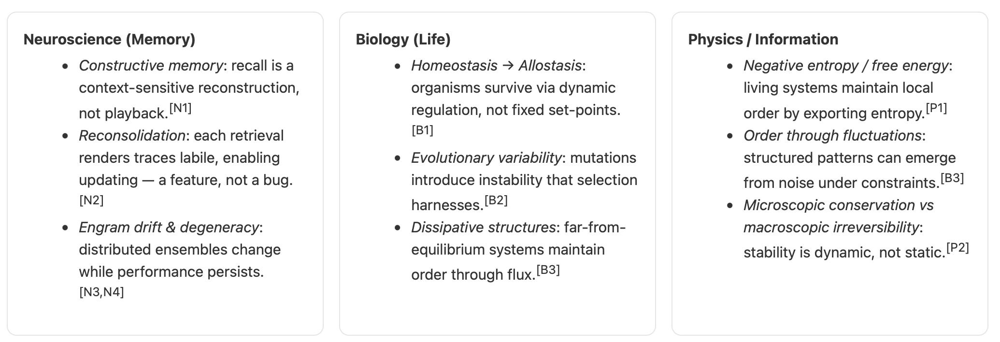
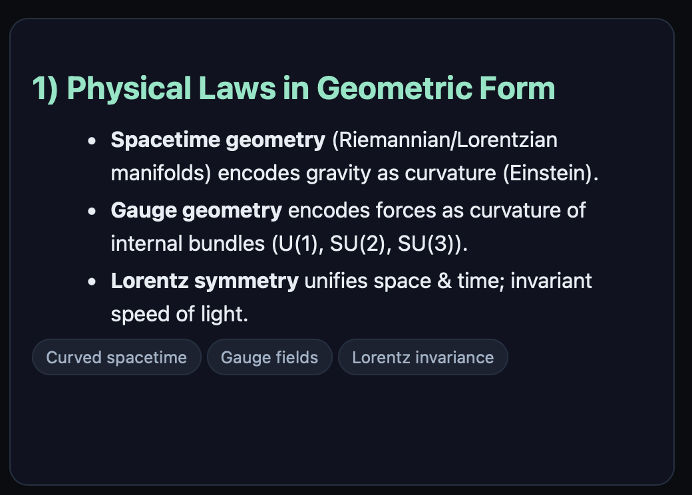
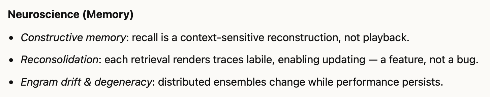

# Library and Book Style Guide

Presentation and authoring approaches for Library documents and Book chapters, including proposed tokens and reader behaviour. The structural work, candidate lists and scan workbook are in the [Library editorial review](Library_Editorial_Review.md).

## Prose, Lists and Panels

Use standard Markdown for ordinary lists. Use short bold lead-ins where they help the reader scan. Keep italics for emphasis, published titles and established notation. The [editorial review](Library_Editorial_Review.md#prose-and-section-review) describes how to choose between prose, a list and a panel.

A panel gives a short example, comparison or definition a simple border. Its contents are ordinary Markdown. A panel may have a short title, rendered as a separately styled label within the border. Use that label for names such as **Neuroscience (Memory)** and **Biology (Life)**. The house outline uses `h1` through `h3` for document structure, and panel labels sit outside that outline.

### Proposed Panel Layout and Authoring

| Arrangement | Reading behaviour |
| --- | --- |
| One full-width panel | The border spans the reading column. Prose continues below. |
| One half-width or third-width panel | Position it left or right. Following prose wraps beside it and continues below. The next document-body heading starts at full width. |
| Two or three consecutive panels | Panels separated only by blank lines form a row of equal halves or thirds. The tallest panel sets the height for the row and the contents align at the top. Prose continues below the row. Width and position choices apply to standalone panels. |

Use the available reading width to decide when to stack. On a phone, each panel occupies the full reading width and panels stack in source order. The 11-inch iPad can retain the desktop arrangement when its reading pane has room. Check the cutoff with real panel text, particularly in a row of three. The existing wrapped-image layout provides the starting point for prose wrapping and clearing at a body heading. [Existing image placement rules](../../reference/Document_And_Catalogue_References.md#wrap-body-text)

In Manage, **Source → Directives → Panel** would wrap the selected Markdown blocks in a paired directive. The author supplies width, side where applicable, and an optional title. **Apply** changes the editor buffer and the usual **Save** generates the document. This is an illustrative source form.

```md
:::panel width=third position=right title="Neuroscience (Memory)"
- *Constructive memory* describes how recall depends on context.
:::
```

The document renderer would render the selected blocks as Markdown inside the border and group consecutive panels for the reader. Shared reader CSS would float a single side panel for prose wrapping, clear it at the next document-body heading, and use Grid to stretch the panels of a row to the same height. Start by checking a single side panel, a two-panel row and a three-panel row on desktop, iPad and phone widths. [Source Directives workflow](../../reference/Source_Editing.md#directives)

The original HTML examples and their imported Markdown show what changes when the panel layout falls away. [Structured Instability — Why Life & Memory Are Alive](/docs/?collection=library&doc=d-20261124-134035-68e613) · [Symmetry & Geometry — Laws, Breaking, and Brains](/docs/?collection=library&doc=d-20261124-154430-75ca91)





This imported source predates the heading cleanup. When these groups become panels, use the original wording of each label in the panel title field.

```md
#### Neuroscience (Memory)

- *Constructive memory*: recall is a context-sensitive reconstruction, not playback.
- *Reconsolidation*: each retrieval renders traces labile, enabling updating — a feature, not a bug.
- *Engram drift & degeneracy*: distributed ensembles change while performance persists.

#### Biology (Life)

- *Homeostasis → Allostasis*: organisms survive via dynamic regulation, not fixed set-points.
- *Evolutionary variability*: mutations introduce instability that selection harnesses.
- *Dissipative structures*: far-from-equilibrium systems maintain order through flux.
```



## Titles, Subtitles and Headings

| Element | Authoring rule |
| --- | --- |
| `h1` / `#` | Use one document title. |
| Subtitle | Put an optional short framing line directly under the title. Give it a dedicated text style in the reader and keep it separate from the Summary. |
| `h2` / `##` | Use for main sections, including the quiet transitions of a short essay. Choose compact styling when a smaller break suits the writing. |
| `h3` / `###` | Use for a subsection within an `h2`. |
| `h4` / `####` | Retire as a house authoring style. Use a panel label for a panel title, or a short bold lead-in when the words belong to the prose. |

Heading levels describe the outline. A flat essay can have a sequence of compact `h2`s. *Tao, Nature and Essence* is a good trial because all five headings mark successive steps in one essay. The absence of `h3`s is an editorial clue for choosing the compact treatment. The saved annotation records that choice if the outline changes later. [Tao, Nature and Essence](/docs/?collection=library&doc=d-20261124-180605-39d7c4) · [W3C heading ranks](https://www.w3.org/WAI/tutorials/page-structure/headings/#heading-ranks)

The proposed compact annotation goes immediately above a Markdown `h2`.

```md
<!-- dotlineform:heading compact -->
## Tao and “nature” in the Chinese sources
```

The document renderer would attach the compact style to that heading. Shared reader CSS could use the current `h3` type and spacing and omit the `h2` divider. The heading retains its text and `h2` level, and the comment follows the existing table option pattern. Use ordinary `##` for main headings while the annotation is a proposal. [Table options syntax](../../reference/Source_Editing.md#table-options)

Try the subtitle treatment with a few long titles before choosing its source form. The [H3 cleanup list](Library_Editorial_Review.md#compact-heading-candidates-from-the-h3-cleanup) and [section scan](Library_Editorial_Review.md#h2-section-scan) give examples to review for compact styling.

## Inline Labels and Keywords

Try `•` for a short sequence of phrases that belong on one line at ordinary widths. Keep natural wrapping on a narrow screen, and use a regular list when each item needs space or explanation. Treat `・` as part of authored text when it carries linguistic or typographic meaning. Review existing separators as part of the passage edit before considering a token. [Tao, Western Lenses, and the Possibility of Reconciliation](/docs/?collection=library&doc=d-20261124-181449-26dfe9) · [Why a Truly Universal Language Is Unattainable](/docs/?collection=library&doc=d-20261124-204035-4291d1)

The imported pills can make a few key words easy to scan. Try them as presentation first. A term that needs an explanation can link to a glossary entry. A document tagging workflow would become useful once there is a clear discovery job for the tags, such as browsing all documents about a particular concept. [Symmetry & Geometry — Laws, Breaking, and Brains](/docs/?collection=library&doc=d-20261124-154430-75ca91)

## Spelling and Notation

Try British English for the edited narrative, including `-ise` where that is the chosen house form and `maths` in ordinary prose. Preserve quotations, names, source titles, code and established technical spellings. Collect recurring decisions in a short word list as they come up, including capitalisation, hyphenation and notation where these affect consistency across chapters.

## Images and Diagrams

Use SVG for new or redrawn diagrams, charts and schematics. Keep photographs, screenshots and raster illustrations in an appropriate raster format. If a WebP diagram needs substantial repair, identify the idea the diagram must explain and redraw the labels and relationships from that idea. Keep the editable diagram source with its owner and add the finished asset through the existing image workflow. [Media intake and SVG](../../reference/Media_And_Asset_Handling.md#svg-and-interactive-assets)

- Give each figure one main purpose. Keep labels short and put longer explanations and source notes in the caption or chapter.
- Use dark strokes for the main structure, lighter strokes for guides and a restrained accent colour for the feature the reader should follow. Reinforce meaning with line styles, shapes or labels.
- Keep label type, line weights, arrowheads and spacing consistent within a family of figures. Try one plain label face and a consistent maths face for symbolic notation. Give labels clearance from lines and arrowheads. Make crossings and intended junctions visually distinct.
- Check a narrow reading size as well as the full-size view. Follow the arrows and read the smallest label. Break a wide or dense drawing into smaller figures when that is what makes it legible.
- Write alt text that conveys what the image shows. Use the caption for what to notice, and use the existing Image detail treatment when the reader needs a larger view. [Image detail](../../reference/Document_Image_Detail.md)

Use the **Bloch sphere** as a reference for spatial diagrams and the **Deutsch circuit** for ordered processes. They show how a quiet palette and consistent marks can make a diagram easier to follow. The circuit also gives a useful narrow-width check because its small Oracle label shrinks noticeably. Use the **Relational Reality Map** to try a redesign of a dense figure. Its four domains and central thesis can remain visible while most of the text inside the nodes moves into the chapter. [Qubit calculations](/docs/?collection=library&doc=d-20261124-212917-2cf593) · [Relational Reality Map](/docs/?collection=library&doc=d-20261123-201501-81489a)

EPUB 3.3 supports SVG as a core image format. Package a self-contained SVG with a `viewBox`, native SVG text and shapes, and its own presentation styles. Keep the caption and alt text in the chapter. Check a sample EPUB in Apple Books at a narrow reading width before treating a figure style as ready for a Book edition. The whole-Book export is a separate proposed delivery. [EPUB 3.3 core media types](https://www.w3.org/TR/epub-33/#sec-core-media-types) · [EPUB reading system requirements](https://www.w3.org/TR/epub-rs-33/#sec-svg) · [Export Book proposal](../Export_Book.md)

### Docs Media Thumbnails

The Thumbs code review traced the browser's existing filter, sort and retained-view state through opening and closing a preview. Content Detail copies target data, so the Manage adapter uses the exact saved image identity to find the live thumbnail and reports when that row is no longer available. It reuses the thumbnail image in the larger pane. The report makes its existing inventory read and loads image bytes as they are needed. The existing asset service owns path confinement and serving. A Manage browser check opened an SVG and a WebP, verified the original asset links, and returned to the scrolled SVG row at the same position with keyboard focus restored. Thumbnail fit remains part of visual review.

See [image review and triage](Library_Editorial_Review.md#image-review-and-triage) for how to use the report during editing.

## Tables

The current preference is small type for tables. Use the existing `small-text` option when editing individual tables. A shared default makes sense if it applies consistently across the agreed scope and the same source needs to show correctly in both the reader and export. Review long words, links and weighted columns at phone, tablet and desktop widths. Use the existing Table detail where a reader benefits from a larger view. Treat responsive behaviour as a separate layout question from type size. [Table options](../../reference/Source_Editing.md#table-options)
