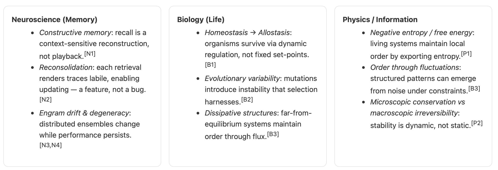

# Library and Book Style Guide

The Library gathers material developed in conversations, from edited chat extracts to summaries. *Living Memory* explores whether a selection can form a coherent reading sequence. This guide sets initial editorial and presentation choices for Library documents and Book chapters, and records which parts of the work merit lasting support.

## Decide What to Keep as a Tool

Use a **one-off pass** when it answers a bounded question or makes a finite set of edits. Save the resulting content or evidence when it will be used again. Use a **report** when you repeatedly need to see material across documents to decide what to work on. Use an **authoring workflow** when the same choice recurs while editing a document and belongs in its saved source. Start with the existing controls where they can express the choice.

| Area | One-off work | Durable home or workflow |
| --- | --- | --- |
| Lists and panels | Review representative imports and rewrite list-heavy passages during chapter editing. | Standard Markdown for ordinary lists. Consider a panel directive if the same clearly named purpose recurs. |
| Titles and subtitles | Compare a few long titles and existing `<small>` lines in web and book layouts. | A subtitle field earns its place if authors need the same treatment across reading and export. |
| Inline labels | Identify useful sequences and recurring terms in the imported designs. | Start with text conventions. Adopt structured tags when there is a defined use such as filtering or term discovery. |
| References | The Library extraction and removal pass is complete. Reuse its JSON for per-document shortlisting. | Keep the inventory as Working editorial data. Maintain Selected Reading and any book bibliography as authored pages. |
| Spelling and grammar | Run a candidate scan by batch and review changes in context. | Follow a small house word list and spelling convention during normal editing. |
| Images | Use the thumbnail snapshot to select a sample and classify the work. | Use Thumbs in Docs Media for recurring cross-document review. Replace or annotate individual images in Source. |
| Tables | Inventory the sizing overrides and check representative dense tables at narrow widths. | Use existing Table options in Source. Consider one default at the agreed scope if small type consistently works. |
| Index and glossary | Collect subject and term candidates from the selected material. | Curate navigable pages in the Library and in the relevant Book edition. |

## Prose, Lists and Panels

Build paragraphs where a passage explains a relationship, makes an argument or changes direction. Keep bullets where the reader benefits from scanning parallel items, and use numbering when the order matters or an item is referred to by number. Use bold selectively for short terms that serve as scan points. Keep italics for emphasis, published titles and established notation.

A panel can group a short example, comparison or definition that the reader will recognise as a unit. During a first pass, try a heading and a short list with the existing Markdown tools. If multiple chapters need a distinct panel treatment, agree its editorial purpose and try it in both web and book layouts before adding a directive. Classifying list shape across the corpus can help find candidates. The decision to turn a list into prose belongs with the passage edit.

The original HTML examples and their imported Markdown show what changes when the panel layout falls away. [Structured Instability — Why Life & Memory Are Alive](/docs/?collection=library&doc=d-20261124-134035-68e613) · [Symmetry & Geometry — Laws, Breaking, and Brains](/docs/?collection=library&doc=d-20261124-154430-75ca91)




The imported text supplies a useful editing sample.

```md
#### Neuroscience (Memory)

- *Constructive memory*: recall is a context-sensitive reconstruction, not playback.
- *Reconsolidation*: each retrieval renders traces labile, enabling updating — a feature, not a bug.
- *Engram drift & degeneracy*: distributed ensembles change while performance persists.

#### Biology (Life)

- *Homeostasis → Allostasis*: organisms survive via dynamic regulation, not fixed set-points.
- *Evolutionary variability*: mutations introduce instability that selection harnesses.
- *Dissipative structures*: far-from-equilibrium systems maintain order through flux.
```


## Titles and Subtitles

Give each document one main heading. A subtitle can add the framing or scope that makes a short title intelligible. The summary can then describe what the document covers. Try the existing `<small>` treatment on a few pages and check its size in a narrow view and its relationship to the main heading. If usage settles, a dedicated subtitle can preserve the title used by navigation and give the subtitle a consistent role in the reader and export.

## Inline Labels and Keywords

Try `•` for a short sequence of phrases that belong on one line at ordinary widths. Keep natural wrapping on a narrow screen, and use a regular list when each item needs space or explanation. Treat `・` as part of authored text when it carries linguistic or typographic meaning. Review existing separators as part of the passage edit before considering a token. [Tao, Western Lenses, and the Possibility of Reconciliation](/docs/?collection=library&doc=d-20261124-181449-26dfe9) · [Why a Truly Universal Language Is Unattainable](/docs/?collection=library&doc=d-20261124-204035-4291d1)

The imported pills can make a few key words easy to scan. Try them as presentation first. A term that needs an explanation can link to a glossary entry. A document tagging workflow would become useful once there is a clear discovery job for the tags, such as browsing all documents about a particular concept. [Symmetry & Geometry — Laws, Breaking, and Brains](/docs/?collection=library&doc=d-20261124-154430-75ca91)

## References and Technical Review

The one-off Library pass removed 317 headed reference sections from 316 documents. The Docs workspace inventory at `working/source/collections/library/reference-inventory.json` holds 2,412 candidate entries, grouped by document ID. It includes a reusable prompt, any original numbering and table notes, and source paths and line ranges for recovery from commit `cad35800db4f`. The bibliographic details are transcribed from the original material. Existing in-text cues were retained for the editing pass.

Use the edited document and its inventory record to ask ChatGPT for a short reading list. Give each selected source a sentence explaining what it offers, and check the identity and bibliographic details of the shortlist. A document can have a short local list when the sources help the reader follow a quotation, an explanation or a figure. A topic-based Library **Selected Reading** page can give readers a route into the material. A Book bibliography can consolidate repeat entries across the chapters that actually appear in that edition.

Treat technical accuracy as part of editing chapters whose purpose is technical explanation. Focus review on the claims, definitions, equations and figures the explanation depends on. Use the bibliography to give readers a route into the subject and keep explicit source relationships where the prose already relies on them.

## Spelling, Grammar and Notation

Try British English for the edited narrative, including `-ise` where that is the chosen house form and `maths` in ordinary prose. Preserve quotations, names, source titles, code and established technical spellings. Collect recurring decisions in a short word list as they come up, including capitalisation, hyphenation and notation where these affect consistency across chapters.

A read-only search can find likely variants across hundreds of documents. Review the resulting candidates by batch before changing source. During a chapter edit, check the rhythm of the prose, transitions left over from chat turns, and consistent use of symbols and terms. Keep automated checks focused on repeatable patterns that the editor can recognise and verify quickly.

## Images and Diagrams

Use SVG for new or redrawn diagrams, charts and schematics. Keep photographs, screenshots and raster illustrations in an appropriate raster format. If a WebP diagram needs substantial repair, identify the idea the diagram must explain and redraw the labels and relationships from that idea. Keep the editable diagram source with its owner and add the finished asset through the existing image workflow. [Media intake and SVG](../reference/Media_And_Asset_Handling.md#svg-and-interactive-assets)

- Give each figure one main purpose. Keep labels short and put longer explanations and source notes in the caption or chapter.
- Use dark strokes for the main structure, lighter strokes for guides and a restrained accent colour for the feature the reader should follow. Reinforce meaning with line styles, shapes or labels.
- Keep label type, line weights, arrowheads and spacing consistent within a family of figures. Try one plain label face and a consistent maths face for symbolic notation. Give labels clearance from lines and arrowheads. Make crossings and intended junctions visually distinct.
- Check a narrow reading size as well as the full-size view. Follow the arrows and read the smallest label. Break a wide or dense drawing into smaller figures when that is what makes it legible.
- Write alt text that conveys what the image shows. Use the caption for what to notice, and use the existing Image detail treatment when the reader needs a larger view. [Image detail](../reference/Document_Image_Detail.md)

Use the **Bloch sphere** as a reference for spatial diagrams and the **Deutsch circuit** for ordered processes. They show how a quiet palette and consistent marks can make a diagram easier to follow. The circuit also gives a useful narrow-width check because its small Oracle label shrinks noticeably. Use the **Relational Reality Map** to try a redesign of a dense figure. Its four domains and central thesis can remain visible while most of the text inside the nodes moves into the chapter. [Qubit calculations](/docs/?collection=library&doc=d-20261124-212917-2cf593) · [Relational Reality Map](/docs/?collection=library&doc=d-20261123-201501-81489a)

EPUB 3.3 supports SVG as a core image format. Package a self-contained SVG with a `viewBox`, native SVG text and shapes, and its own presentation styles. Keep the caption and alt text in the chapter. Check a sample EPUB in Apple Books at a narrow reading width before treating a figure style as ready for a Book edition. The whole-Book export is a separate proposed delivery. [EPUB 3.3 core media types](https://www.w3.org/TR/epub-33/#sec-core-media-types) · [EPUB reading system requirements](https://www.w3.org/TR/epub-rs-33/#sec-svg) · [Export Book proposal](Export_Book.md)

### Browse and Triage Images

The one-off Library contact sheet showed the value of a visual pass without opening each document. Use **Docs Media → Working → Thumbs** with the Library filter to browse the saved results and open larger previews. **Referenced by** links to the documents that use each image. [Docs Media](/docs/?doc=d-20260812-212735-6d9cf3) · [Docs Media inventory](../reference/Media_And_Asset_Handling.md#docs-media-inventory-report)

For the first pass, use a temporary list of images marked **Keep**, **Repair**, **Redraw** or **Remove**. Record a short decision against the owning document and filename as needed. Start with a small batch from chapters likely to be edited. Consider saved review status only if a second pass needs to pick up outstanding decisions across sessions.

The Thumbs code review traced the browser's existing filter, sort and retained-view state through opening and closing a preview. Content Detail copies target data, so the Manage adapter uses the exact saved image identity to find the live thumbnail and reports when that row is no longer available. It reuses the thumbnail image in the larger pane. The report makes its existing inventory read and loads image bytes as they are needed. The existing asset service owns path confinement and serving. A Manage browser check opened an SVG and a WebP, verified the original asset links, and returned to the scrolled SVG row at the same position with keyboard focus restored. Thumbnail fit remains part of visual review.

## Tables

The current preference is small type for tables. Use the existing `small-text` option when editing individual tables. Do a one-off inventory of the Library settings and review a few narrow and wide examples before deciding whether to bulk-adjust the Markdown or make small type the default at the agreed scope. A shared default makes sense if it applies consistently across that scope and the same source needs to show correctly in both the reader and export.

Tables earn their space when rows and columns help compare like items. Shorten crowded headings and keep lengthy explanations in prose. Review long words, links and weighted columns at phone, tablet and desktop widths. Use the existing Table detail where a reader benefits from a larger view. Treat responsive behaviour as a separate layout question from type size. [Table options](../reference/Source_Editing.md#table-options)

## Index and Glossary

Give the Library a curated subject index with links to useful documents. Try placing it near the top of the Library if it becomes a regular route into the collection. Make a separate glossary for terms readers may want to look up, with a short definition and links to the places that explain or use the term.

For *Living Memory*, try a glossary and selective subject index in the back matter. Link to included chapters or headings in the edition. Use chapter links for reflowable EPUB and decide on page references when there is a fixed-page edition. Start with authored Markdown pages assembled from a one-off extraction of candidate subjects and terms. Consider a generator when the material has dependable term or heading anchors and rebuilding it has become a recurring job. [Book editions](../reference/Collections_And_Books.md#book-editions) · [Export Book proposal](Export_Book.md)

## First Editorial Pass

Choose a few chapters likely to be used together in *Living Memory*. Give each a prose pass, shortlist its reading where useful, and review its figures and tables at the intended reading width. Use Docs Media Thumbs to find the qubit figures and the denser map for the first image review. Record the rules that work across the sample here.
