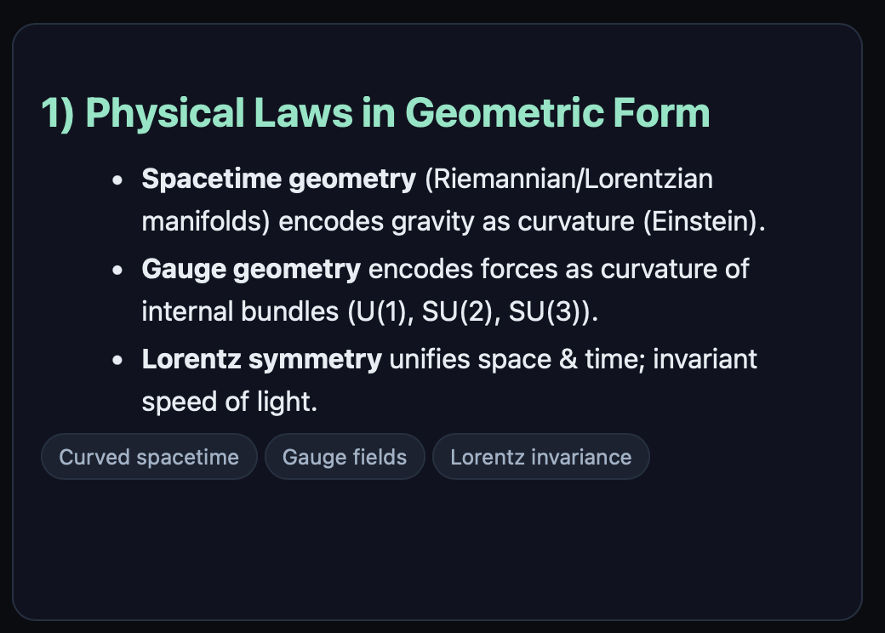
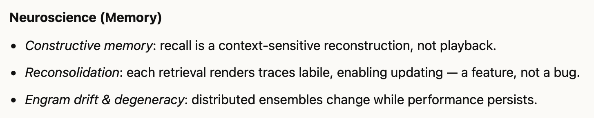

# Doc Styles

implement a consistent style for presenting source markdown in html

## bullet points and lists

problem is that docs have too many bullet point lists in body text, because often in source docs they are presented as 'panels'  

other times this was the default style of ChatGPT - which called for concise, quick responses. also the source docs were not necessarily written as part of a narrative; they were always intended as 'notes' which need to rewritten/compiled - which is what we are doing now.

the source docs also don't employ consistent use of bullets + bold  

- some bullet lists should be retained,
- others displayed as panels, 
- others should be rewritten as normal paragraphs.

source html:
[Structured Instability — Why Life & Memory Are Alive](/docs/?collection=library&doc=d-20261124-134035-68e613)

[Symmetry & Geometry — Laws, Breaking, and Brains](/docs/?collection=library&doc=d-20261124-154430-75ca91)

imported markdown:

#### Neuroscience (Memory)

- *Constructive memory*: recall is a context-sensitive reconstruction, not playback.
- *Reconsolidation*: each retrieval renders traces labile, enabling updating — a feature, not a bug.
- *Engram drift & degeneracy*: distributed ensembles change while performance persists.

#### Biology (Life)

- *Homeostasis → Allostasis*: organisms survive via dynamic regulation, not fixed set-points.
- *Evolutionary variability*: mutations introduce instability that selection harnesses.
- *Dissipative structures*: far-from-equilibrium systems maintain order through flux.

current:

across the docs there are several different styles used for bullet lists
e.g.

bold, bullet + plain text, bullert + italic

so need to decide if we need a single consistent style

## title + subtitle

using <small> as a subheading for long titles
could wrap the h1 and this into a token to make the semantics and style consistent without breaking the h1 (i.e. introducing a fake 'subtitle' style)
maybe need a bigger font than 'small'

## 'tag' pills

in the bullet points screenshots, the source docs often create pills to indicate word-tags. these don't link to anything but visually act as key words.  
we don't currently have any tagging capability for documents - for Catalogue works we have Concepts.

see [Symmetry & Geometry — Laws, Breaking, and Brains](/docs/?collection=library&doc=d-20261124-154430-75ca91)

## References

currently using different formats for this section  
fundamentally need to decide whether to include in a doc/chapter or whether to push to separate index of recommended reading / references?

## spelling and grammar

e.g. American vs UK English

z vs s
math vs maths

how to check and correct it across 100s docs?

