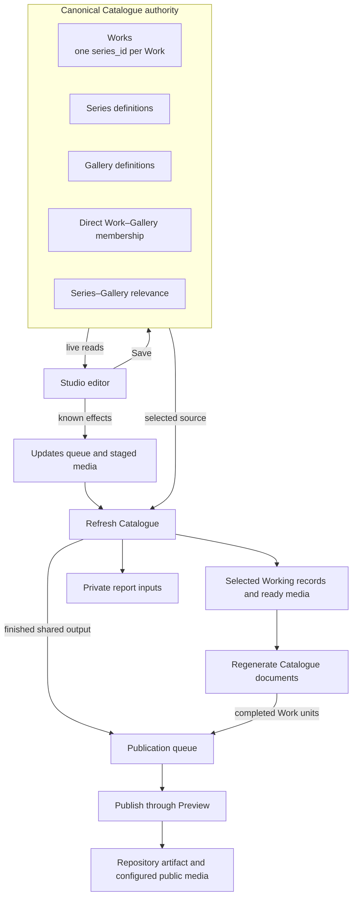

# Catalogue Data Model Map

## Purpose

Each Work has one Series and may belong to any number of Galleries. Series–Gallery relevance is authored separately from direct Work membership. This lets a Series surface a relevant Gallery without putting all its Works in that Gallery. A document can refer to a Work without changing either relationship. [Catalogue Source Model](Catalogue_Source_Model.md#relationships-and-identity) · [Semantic Tokens Architecture](Semantic_Tokens_Architecture.md#catalogue-identity-and-document-associations)

## Diagram

## Artefact Register

| Artefact or family | Authority or producer | Reader and refresh boundary |
| --- | --- | --- |
| `studio/data/canonical/catalogue/` | Studio canonical transactions | Live editor records and lookups |
| Projects `catalogue/media-staging/` and Docs `working/catalogue-updates-pending.json` | Studio mutation completion | Exact pending changes for Refresh |
| Docs `working/generated/catalogue/` and `working/assets/works/` | Refresh Catalogue | Selected ready Working Catalogue records, indexes, media and private reports |
| Working Catalogue document source and by-ID payloads | Regenerate and exact document Build | Working Catalogue reader and completed publication selections |
| `site/assets/data/catalogue/`, `site/assets/data/docs/catalogue/` and configured R2 media | Publish through Preview | Repository artifacts reach public readers through Pages deployment. Media transfers take effect at Publish. |

Catalogue JSON and generated document payloads are replaceable outputs. The [Catalogue Source Model](Catalogue_Source_Model.md#canonical-families) lists the exact canonical families. The [payload contract](Catalogue_Indexes_And_Payloads.md#generated-read-models) lists the current generated files and their consumers.

## Change And Recovery

Save can complete while Docs readers still show the previous output. Refresh and Regenerate carry exact effects forward so a correction can resume from unfinished queue entries after the cause is fixed. Publish consumes completed selections. [Catalogue Save And Refresh](Catalogue_Save_And_Refresh.md#current-workflow) · [Catalogue Deployment](Catalogue_Deployment.md)
