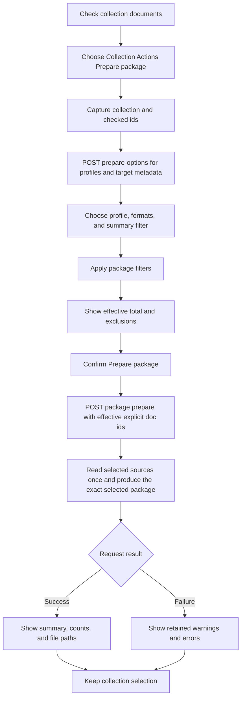

# Package Prepare

## Purpose

Use **Prepare package** in a Collections report to create one JSON or JSONL working package from checked documents in that configured collection. Preparation reads the exact owning source collection and writes package artifacts; it does not change document source, metadata, or publication state. The Index and workspace Actions have no package entry point.

## Prepare A Package

1. Open a Collections report in Docs Viewer Manage and check documents through Collection Actions.
2. Choose **Collection Actions → Prepare package**; **All** remains local to that collection.
3. The action captures the collection and exact checked IDs before loading package options.
4. Choose the profile, package format, and content format when the profile supports a choice.
5. Flat collections have no descendant expansion or descendant option.
6. For **Document content**, optionally select **Only documents missing summaries**.
7. Review **Total documents to be prepared** and any included or excluded counts.
8. Choose **Prepare package** to confirm once.
9. Review the result summary, counts, file paths, warnings, or errors.

Checked documents remain selected after cancel, success, or failure. Choose **Clear** or **Done** to change or leave collection selection mode.

## Selection Rules

- Collection preparation uses its checked IDs only; displayed, highlighted, focused, and context-menu rows do not become implicit collection targets.
- One checked collection document and several checked collection documents use the same Action and modal.
- Working is resolved by the package service; there is no workspace picker.
- Collection **All** updates the checkbox-selection owner. Application Prepare accepts explicit IDs only.
- A collection request carries its exact configured `collection`; its flat records never expand descendants or borrow ordinary parent/sibling IDs.
- The modal starts with the captured checked IDs, applies missing-summary filtering, then any configured maximum document count. It trusts the options service's exact selected-source metadata without another membership audit.
- Only that final effective ID set and formats are sent. The service consumes the completed choice without summary filtering, limit filtering or descendant expansion. It retains exact owner/source identity, confined reads and required profile/output checks.

## Modal Filters And Total

**Document content** offers one package-composition filter:

- **Only documents missing summaries** is off by default. A missing summary is empty or whitespace-only source `summary` metadata.

**Document tree** includes the checked flat records without body content and does not offer the missing-summary filter. Draft and Publish exclusion state do not filter package membership.

The displayed total is the final effective target for the loaded source snapshot. The modal reports documents deliberately excluded by the filter or profile limit. Those pre-submit exclusions are not result `skipped` documents. When no document remains, the modal reports why and disables **Prepare package**.

## When The Action Is Unavailable

**Prepare package** requires checked collection documents and is disabled with no selection. Existing collection restrictions remain, including Catalogue's package restriction. An unavailable package workspace or preparation failure is reported by the workflow. Resolve the condition and use the same action again.

## Package Output

A successful request reports the generated package and metadata paths. The selected profile determines JSON or JSONL shape, included fields and supported format choices. [Documents Prepare Profiles](Package_Prepare_Profiles.md) records those profile contracts.

Package Summary is consistently one paragraph: whitespace, including line and paragraph breaks, is collapsed to spaces in `summary`, `current_summary` and any expanded `[[summary]]` body text. Preparation renders a package-only flattened Summary value; it does not alter canonical source or flatten the document's unrelated body paragraphs. Structured fields contain normal JSON strings without YAML markers, and each JSONL record remains one physical line. Missing-summary filtering still treats whitespace-only source values as empty. Returned-package comparison flattens both the staged `current_summary` and current source value, so presentation-only breaks do not create a mismatch.

Summary metadata fields retain authored emphasis markers as text, preserving returned-summary comparison and authoring intent. An expanded Summary in body content uses the shared restricted emphasis renderer after package-only whitespace flattening; the selected HTML, Markdown or plain-text body transform handles its formatting through the existing content path. Prepared records do not acquire the reader's `summary_html` field.

Supported returned Import applies the supplied Summary string. Returning the prepared single-paragraph value can therefore remove source line/paragraph breaks; they are not reconstructed. An externally supplied multiline Summary remains a multiline string and is written using `|-` when source is serialized. Docs Review retains the returned value under its existing read-only authority. [Builder](Builder.md#summary-block) owns source syntax and newline-preserving reader/HTML Export behavior. Existing prepared files are not rewritten by this policy; prepare a new package to obtain current output.

Configured collection packages are export-only unless both the collection and profile enable returned-package import. Application requests require the exact `collection`; the owning service resolves Working.

Content-bearing preparation carries selected rendered HTML and its Catalogue reference envelope into the shared `docs_catalogue_static.py` preparer before HTML/Markdown/plain-text and heading transformations. One request reuses selected Work/policy/relationship inputs and its existing rendered-content cache. This preserves current Work titles/captions and Catalogue Entry content after Build became reference-only. It adds no media packaging, document generation, queue work or private source lookup; tree-only profiles construct no presentation owner. [Generated Data Contracts](Generated_Data_Contracts.md#catalogue-reference-and-presentation) owns the shared reference/presentation fields.

For engine commands, output fields, validation details, and workspace requirements, use [Documents Package Preparation Script](Package_Prepare_Script.md). Returned packages remain a separate whole-package workflow.

## UI And Action Calls

Options uses one `POST /docs/packages/prepare-options` carrying captured `doc_ids` and required exact `collection`. It returns profiles and metadata for only the checked flat documents, reading no unselected bodies and doing no body rendering or Subject/readiness/model validation. There is one collection-report lazy bridge and one modal workflow. The Index bridge, subtree discovery/expansion and flat-versus-tree mode flag are removed without aliases.

Confirmation sends one `POST /docs/packages/prepare` with required `collection`, final `doc_ids`, `profile_id`, `target_format`, `content_format` and optional `dry_run`. It carries no `select_all`, missing-summary or publication-eligibility flags. Selected source text is read once. Tree output needs no generated manifest or rendering owner; content output consumes saved collection/link metadata and one lazy collection content renderer/cache. It does not read the ordinary Index, construct unused by-ID metadata or render unselected source bodies. Required report/token rendering, URL safety, escaping, profile/format/output/collision checks and provenance remain with their owners. The independent CLI and returned-package/current-source formats retain their separate paths; ordinary CLI packages have no application Import entry point. No document, Search or media generation runs.

## Result Counts

The result modal always orders document counts as:

1. `selected`
2. `exported`
3. `failed`
4. `skipped`
5. `truncated`

The invariants are:

`selected = exported + failed + skipped`

`truncated <= exported`

| Field | Meaning |
| --- | --- |
| **selected** | The effective ids submitted from the modal. For unchanged source state, this equals **Total documents to be prepared**. |
| **exported** | Selected documents whose package records were built successfully. |
| **failed** | Selected documents whose records could not be built. Any failures prevent the package being written. |
| **skipped** | Zero for application Prepare: modal exclusions happen before submission and the service does not reapply filters. CLI filtering retains its own skipped records. |
| **truncated** | Exported documents whose content was shortened by the profile limit. It counts documents, not characters. The current content profile limits content to 50,000 characters and adds `[truncated]` at a paragraph boundary. |

### Failed

For the **failed** count, the most likely per-document causes are:

- A required field is empty—currently `doc_id`, `title`, and rendered `content` are required.
- The source document cannot be rendered into HTML.
- Rendered HTML cannot be converted into the requested Markdown or plain-text content.
- Less commonly, a package-profile defect: unsupported field source or transform, invalid field mapping, or blank output path. These should normally be caught by profile validation first.

Each selected document either produces a record or increments `failed`; any record-building error prevents the package from being written. The error details should identify the document and cause. The implementation is in `docs-viewer/services/docs_document_packages/export_transforms.py`.

Some operation-level problems do **not** increment `failed`, because processing never reaches individual documents—for example:

- Package workspace missing or unwritable.
- Invalid profile or format.
- Unsafe output path.
- Metadata/output filename collision.
- Missing configured source root.
- Missing, unreadable or malformed selected source, or source-filename/ID disagreement.
- Service or request failure.

Those appear as an overall preparation error, generally with zero document counts.

### Skipped

Modal exclusions occur before submission and are explained beside the total. They do not inflate `selected` or `skipped`.

After submission, the service reads the exact selected sources and does not reapply the modal's summary choice. A missing or unprocessable selected source fails the operation; it is not silently skipped or replaced. No freshness protocol or fallback selection is added.

Both current profiles set `max_documents` and `max_total_chars` to `null`, so there is no package-wide document or character limit. The active 50,000-character content limit per **Document content** record produces `truncated`, not `skipped`.

## Verification

On 2026-10-19 the existing application preparation service completed `document-content` dry-runs for Catalogue `00008` and Works `d-20260801-073846-e0a9ec`, using JSON output and Markdown content. Each selected/exported one record with zero failures, skips, truncation, warnings or errors. No package output was written; the normal operation log was appended. These representative Entry and image/summary paths exercise the shared static adapter but do not establish actual package-file writing, all output formats, returned-package behavior or browser acceptance. No tests ran.

[User Facing Rules](data/User_Facing_Rules.md) M.06/M.22 records focused lint, compilation/import diagnostics and distinct source/diff review for this cleanup. These checks do not establish live behavior. No tests or live preparation ran; existing retired-contract package tests require separately agreed review/migration. Manual acceptance remains for subtree and flat selections, profiles/formats, Summary filtering, tree/content output, supported reports/tokens/relationships, unavailable or failing selected input and output/collision errors. Restart Docs Viewer and force reload before review.
